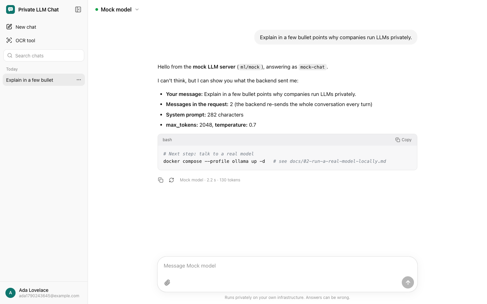
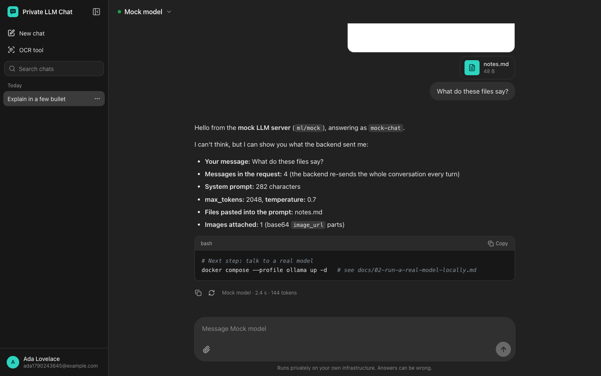
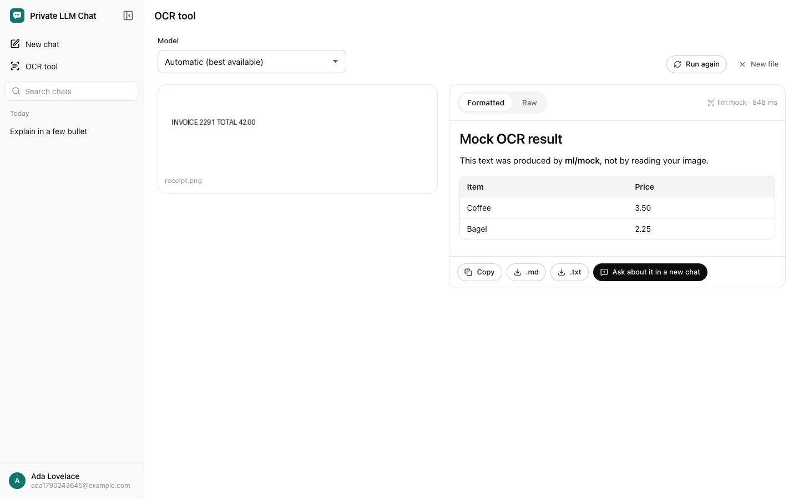
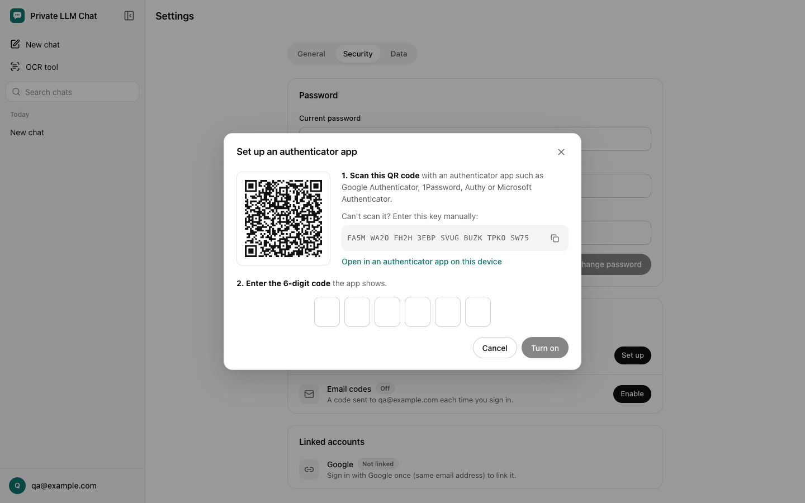
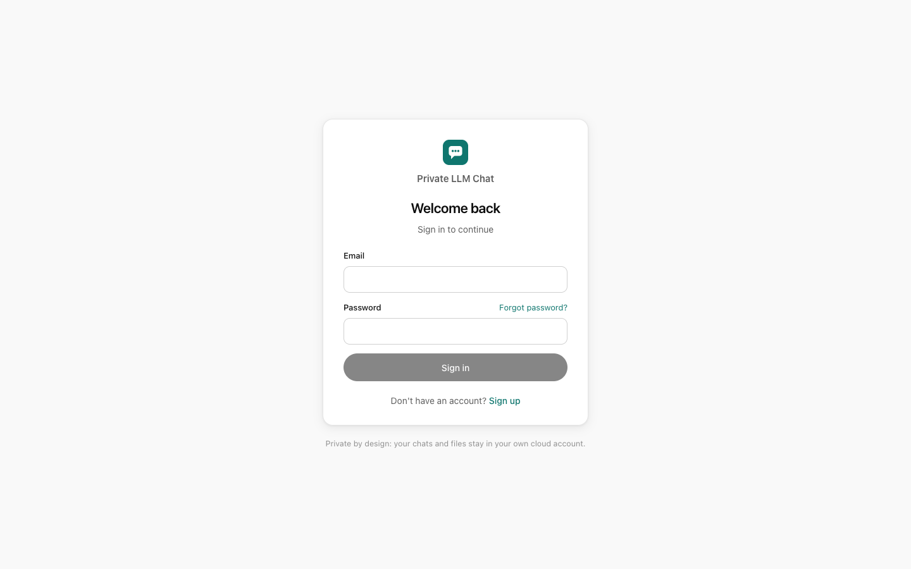
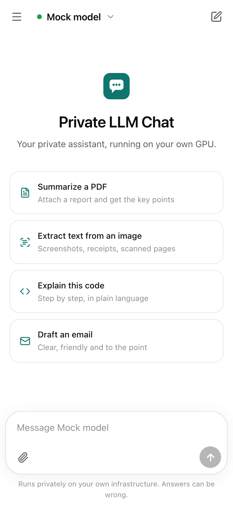
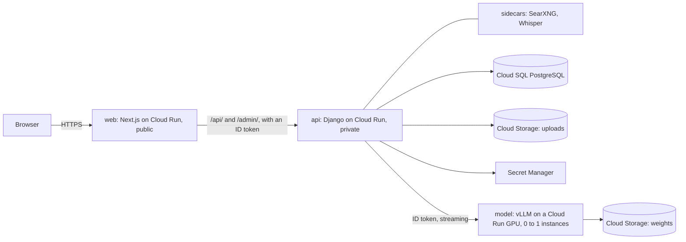

<div align="center">

# Private LLM Chat on Google Cloud Run

**Your own ChatGPT, on your own GPU, in your own Google Cloud project.**

Deploy open-source LLMs (Qwen, Llama, Gemma...) on Cloud Run GPUs with vLLM, and put
a real ChatGPT-style app in front of them: accounts with Google sign-in and two-factor
auth, streaming chat, documents and images, OCR, web search, voice input, and a GPU
that sleeps when nobody is chatting and wakes up on the next message.

[](https://github.com/codewithmuh/private-llm-chat-cloudrun-gcp/actions/workflows/ci.yml)
[](LICENSE)


[Quick start](#quick-start-no-gpu) ·
[Learning path](#choose-your-path) ·
[Concepts](docs/concepts.md) ·
[Architecture](docs/architecture.md) ·
[Deploy on Google Cloud](docs/04-deploy-the-full-stack-on-google-cloud.md) ·
[Docs](docs/)



</div>

---

> Prefer AWS? The same app, with the model on Amazon SageMaker, lives in
> [private-llm-chat-sagemaker-aws](https://github.com/codewithmuh/private-llm-chat-sagemaker-aws).

## Why this exists

Sending company documents, customer data or private notes to a third-party AI API is
often not an option. Running the model yourself is, but the path from "I have a
Google Cloud account" to "my team has a private ChatGPT" is scattered across a hundred
blog posts.

This repository is that path in one place, **from a laptop demo to a production
deployment**, with every step explained:

- **Private by design.** The model, the database and the files stay in your Google
  Cloud project and region. The model service is private: Cloud Run only lets a
  request through with a Google ID token from your app's service account. No API key
  to leak. Prompts are never logged.
- **Cost-aware.** A model service scales to zero: no instance and no GPU bill while
  nobody chats. The next message wakes it in about 1–3 minutes. A forgotten GPU is the
  number one surprise bill; here an idle GPU stops by itself.
- **Any model.** Pick a preset or any Hugging Face model vLLM supports. Swap models
  without touching the app. The same app also talks to Ollama, LM Studio or any
  OpenAI-compatible server.
- **Made for learning.** Beginner-friendly guides, code that explains *why*, and a
  real open-source model on your laptop on day one, no GPU needed. Only Docker to
  install: even `gcloud` and Terraform run from Docker images.

## Features

| | |
|---|---|
| **Chat** | Streaming answers, conversation history with search, rename and pin, regenerate, stop, Markdown with code highlighting, tables and math, per-user custom instructions, model picker, dark mode |
| **Documents & images** | Attach PDFs, Word files, text and code. Their text goes into the prompt, trimmed to fit the model's context window. Images go to vision models as pictures |
| **OCR** | Extract text from photos, screenshots and scanned PDFs with a vision LLM, falling back to Tesseract on the CPU. Copy, download, or chat about the result |
| **Web search** | A **Search** button, like ChatGPT's: the app looks the question up with a self-hosted [SearXNG](https://docs.searxng.org) (no API key), reads the top pages, and the model answers from them with numbered citations and a sources list. Up-to-date answers from a model with old training data |
| **Voice input** | A **microphone** button, like ChatGPT's: speak, and the words appear in the message box to edit and send. Transcribed by [Whisper](https://github.com/ggml-org/whisper.cpp) in a container next to the app, so your voice never leaves your infrastructure |
| **Accounts** | Email + password with email verification, password reset, **Sign in with Google**, **two-factor auth** with an authenticator app (TOTP) or email codes, recovery codes |
| **Models** | Cloud Run GPU services (vLLM's official image: nothing to build), any OpenAI-compatible server (vLLM, Ollama, Docker Model Runner, LM Studio), a mock for development |
| **Scale to zero** | Each model sleeps when nobody chats and wakes on the next message. The UI shows "Waking up the GPU" meanwhile; the admin shows each model's status, with **Check now** and **Wake up now**. `min_instances = 1` keeps a model warm |
| **Google Cloud infrastructure** | Terraform: Cloud Run (web, api, one GPU service per model), Cloud SQL for PostgreSQL, private Cloud Storage, Secret Manager, Artifact Registry, Cloud Build, GitHub Actions with Workload Identity Federation (no keys) |
| **Developer experience** | `make up` for the whole stack in Docker, Mailpit to see emails, 100+ backend tests, offline Terraform tests, CI for backend, frontend, Terraform and Docker builds |

## Screenshots

| Dark mode | OCR tool | Two-factor setup |
|---|---|---|
|  |  |  |

| Sign in | Mobile |
|---|---|
|  |  |

<sub>Screenshots use the built-in mock model, which answers by describing what the backend sent it.</sub>

## Architecture



The browser only ever talks to the **web** service. It serves the pages and forwards
`/api/` and `/admin/` to the private **api**, so the login cookie works on one
address. When you press **Send**, the api checks that the model is awake (if it's
asleep, it wakes it and the UI says so), builds the prompt (conversation history, your
files, your instructions, trimmed to fit), streams the request to vLLM, and relays
each token to your browser as Server-Sent Events. Details and diagrams:
[docs/architecture.md](docs/architecture.md).

## Choose your path

Each level builds on the previous one. Stop wherever you have what you need.

| Level | You get | Time | Cost | Guide |
|---|---|---|---|---|
| **1. Local** | The full app on your laptop, with a real open-source model you pick | 15–30 min (downloads) | free | [01-quickstart-local](docs/01-quickstart-local.md) |
| **2. More models, faster** | Switch models, and run them on your Mac's or PC's GPU with Docker Model Runner | 10 min | free | [02-run-a-real-model-locally](docs/02-run-a-real-model-locally.md) |
| **3. Your GPU on Cloud Run** | A private model on a Cloud Run GPU in your Google Cloud project, used by the app still on your laptop | 30 min | about $1.05–1.42 per hour awake, $0 asleep | [03-deploy-a-model-on-cloud-run](docs/03-deploy-a-model-on-cloud-run.md) |
| **4. Everything on Google Cloud** | The app on a public HTTPS URL for your team, with a GPU that sleeps when nobody chats | 1–2 h | about $12–15/month + GPU hours | [04-deploy-the-full-stack-on-google-cloud](docs/04-deploy-the-full-stack-on-google-cloud.md) |
| **Concepts** | How LLMs work (tokens, sizes, GPU memory, quantization, speed, RAG) and how every part of this app works, on your laptop and on Google Cloud | read anytime | free | [concepts](docs/concepts.md) |
| **5. Advanced** | Always-warm GPUs, a 32B model on the 96 GB RTX PRO 6000, your own domain, CI/CD | as you go | depends | [05-advanced](docs/05-advanced.md) |

## Quick start (no GPU)

You need Docker, about 15 GB of free disk and 8 GB of memory.

```bash
git clone https://github.com/codewithmuh/private-llm-chat-cloudrun-gcp.git
cd private-llm-chat-cloudrun-gcp
make up
```

The first time, `make up` asks which open-source model to run (Qwen3-VL, Gemma 3,
Llama 3.2...), downloads it, and connects the app to it. Then:

- Chat app: **http://localhost:3000** (sign up; the verification code arrives in Mailpit)
- Emails: **http://localhost:8025**
- Admin: **http://localhost:3000/admin/**

The browser only uses port 3000: the web container forwards `/api/` and `/admin/` to
the api, exactly as the web service does on Cloud Run. (The api also answers on
http://localhost:8000, for `curl`.)

On a Mac with Apple silicon (or an NVIDIA PC) it offers to turn on Docker Desktop's
**Model Runner**, which runs the model on the GPU. `make model` switches models;
[guide 2](docs/02-run-a-real-model-locally.md) explains the options. New to all this?
[RUN_LOCALLY.md](RUN_LOCALLY.md) walks you through it from zero.

## Deploy a model to a Cloud Run GPU

Create a Google Cloud project with billing, put `GCP_PROJECT=<your project id>` in
`.env`, then:

```bash
make gcp-login                         # once: sign in (gcloud runs in Docker)
make model-deploy PRESET=qwen3-vl-8b   # first time about 20-30 min (copies the model), later about 5 min
make model-chat PRESET=qwen3-vl-8b     # one test message; wakes the GPU if it's asleep
make up-cloud                          # the local app, now with your Cloud Run model
make model-delete PRESET=qwen3-vl-8b   # remove the service when you're done
```

[`ml/cloudrun/deploy.py`](ml/cloudrun/deploy.py) prints every `gcloud` command it
runs (add `--dry-run` to see them without running anything), so you can read exactly
how it works: an Artifact Registry cache of Docker Hub for vLLM's image, Cloud Build
copying the weights from Hugging Face into a Cloud Storage bucket once, and a private
Cloud Run service with one GPU and 0 to 1 instances. Asleep, it costs nothing. Full
walkthrough: [docs/03-deploy-a-model-on-cloud-run.md](docs/03-deploy-a-model-on-cloud-run.md).

## Deploy everything to Google Cloud

```bash
cp infra/terraform/terraform.tfvars.example infra/terraform/terraform.tfvars   # set project_id
make gcp-login   # once, with GCP_PROJECT in .env
make deploy      # Cloud Build builds the images, copies the models, Terraform rolls it all out
```

`make deploy` ends by printing the app's address, a `https://...run.app` URL with
HTTPS and no domain needed. The first run is the slow one: building the images (about
10 minutes), copying each model's weights, and creating the Cloud SQL database (about
10–15 minutes). Full walkthrough, including Google sign-in,
email and deploying from GitHub Actions:
[docs/04-deploy-the-full-stack-on-google-cloud.md](docs/04-deploy-the-full-stack-on-google-cloud.md).
Cost breakdown: [docs/cost.md](docs/cost.md).

## Models

| Preset | Model | GPU | CPU, memory | ≈ $/hour awake | Vision/OCR |
|---|---|---|---|---|---|
| `qwen3-vl-8b` (default) | Qwen3-VL 8B FP8 | NVIDIA L4, 24 GB | 8 vCPU, 32 GiB | 1.42 | yes |
| `qwen3-vl-4b` | Qwen3-VL 4B | L4 | 4 vCPU, 16 GiB | 1.05 | yes |
| `qwen3-8b` | Qwen3 8B FP8 (thinking) | L4 | 8 vCPU, 32 GiB | 1.42 | |
| `llama-3.1-8b` | Llama 3.1 8B Instruct (gated) | L4 | 8 vCPU, 32 GiB | 1.42 | |
| `gemma-3-4b` | Gemma 3 4B (gated) | L4 | 4 vCPU, 16 GiB | 1.05 | yes |
| `qwen3-32b` | Qwen3 32B FP8 (thinking) | NVIDIA RTX PRO 6000, 96 GB (preview) | 20 vCPU, 80 GiB | see the pricing page | |

Prices are approximate for us-central1, October 2026, and only while the model is
awake: $0 while it sleeps. Check [cloud.google.com/run/pricing](https://cloud.google.com/run/pricing).
`make model-presets` lists them; any model vLLM supports works too. How to size the
GPU and add your own: [docs/models.md](docs/models.md).

## Costs, in short

All numbers are estimates (us-central1, October 2026):

- **The app itself**, mostly idle: about **$12–15/month**. Most of it is the small
  Cloud SQL database (about $9–10, plus about $1.70 for its 10 GB disk); Cloud Run,
  Cloud Storage and Artifact Registry cost little while idle.
- **A model on an L4 GPU**: about **$1.05–1.42/hour while awake**, $0 asleep. Each
  wake-up costs roughly $0.35–0.50 (start-up, plus up to ~15 idle minutes before it
  goes back to sleep).
- **Example:** 2 hours of chat a day on 22 days ≈ 44 h × $1.42 ≈ $62, plus the app,
  ≈ **$75/month**. A model kept always warm (`min_instances = 1`) is about
  $1,037/month.

Set a budget with alerts (Billing → Budgets & alerts) before you deploy a GPU. Details:
[docs/cost.md](docs/cost.md).

## Repository layout

```
├── backend/                  Django REST API: accounts & 2FA, chat streaming, files & OCR,
│                             model providers, waking Cloud Run models (+ tests)
├── frontend/                 Next.js ChatGPT-style UI; also forwards /api/ and /admin/ to the api
├── ml/
│   ├── cloudrun/             deploy.py: one model on a Cloud Run GPU, with plain gcloud commands
│   ├── models/               catalog.json: tested model presets
│   └── mock/                 fake OpenAI-compatible model server, for development
├── infra/
│   ├── terraform/            the whole Google Cloud stack, one .tf file per topic (+ offline tests)
│   └── cloudbuild/           images.yaml: builds the four images in Google Cloud
├── search/                   SearXNG, behind the Search button
├── speech/                   Whisper (whisper.cpp), behind the microphone button
├── scripts/
│   ├── up.sh                 the local stack and model menu (make up)
│   ├── gcloud.sh             gcloud from Google's Docker image (make gcp-login, make gcloud)
│   ├── terraform.sh          Terraform from its Docker image (make tf-plan, ...)
│   ├── deploy.sh             the full deploy (make deploy)
│   └── bootstrap-state.sh    a Cloud Storage bucket for Terraform state
├── config/                   model lists for local use; models.cloudrun.example.json
├── docs/                     guides (01–05) and reference
├── .github/workflows/        ci.yml (checks), deploy.yml (deploy from GitHub Actions, off by default)
├── docker-compose.yml           local stack: web, api, postgres, mailpit, searxng, whisper, mock-llm (+ ollama)
├── docker-compose.cloudrun.yml  the same, using your models on Cloud Run GPUs (make up-cloud)
└── Makefile                  `make help` lists everything
```

## Tech stack

| Layer | Choice | Why |
|---|---|---|
| Model serving | **vLLM** on **Cloud Run GPUs** | Fast (continuous batching, paged attention), OpenAI-compatible, runs almost every open model; Cloud Run gives a private HTTPS service that scales to zero, billed by the second |
| Backend | **Django 5.2 LTS** + Django REST Framework, gunicorn | Batteries included (auth, admin, migrations); SSE streaming with threaded workers |
| Frontend | **Next.js 16**, React 19, TypeScript | The standard for chat UIs; also the one public entry point, forwarding API calls to the private api |
| Database | **PostgreSQL 17** (Cloud SQL) | Users, chats, model registry |
| Files | **Cloud Storage** (private) + signed URLs | Durable and cheap; never public |
| Auth | Django auth, **pyotp** (TOTP), **google-auth** (ID tokens) | Explicit code you can read, no black box. ID tokens also open the private Cloud Run services |
| Infra | **Terraform**, Cloud Run, Cloud SQL, Secret Manager, Artifact Registry, Cloud Build | Serverless containers; HTTPS with no domain needed; no keys anywhere |
| Local | Docker Compose, **Mailpit**, **Ollama**, Docker Model Runner | The whole system on a laptop |

## FAQ

**Do I need a GPU on my laptop?** No. Levels 1 and 2 run on any machine (level 2 is
faster with a GPU or Apple silicon). The cloud GPU lives on Cloud Run.

**Why Cloud Run and not a plain GPU VM?** It scales to zero by itself: no instance and
no GPU bill while nobody chats, and no controller for you to run. Only your api can
call the model (Google ID tokens, no API key), and a project's first GPU deploy in a
region gets 3 NVIDIA L4 GPUs of quota automatically. The serving container is vLLM's
official image, so moving to a VM, GKE or on-prem later is easy: the app only needs
an OpenAI-compatible URL (`provider: "openai"`).

**What happens when the GPU is asleep?** Your next message wakes it: the chat shows
"Waking up the GPU" for about 1–3 minutes while Cloud Run starts an instance and vLLM
loads the weights from your Cloud Storage bucket. After about 15 idle minutes it goes
back to sleep. To keep a model always warm, set `min_instances = 1` (billed 24/7).

**Why not the Gemini API?** Gemini is a closed model behind an API: you can't pick an
open model or its settings, and there is less to learn. This project is about running
the model yourself. Any OpenAI-compatible API can still be added as a model for
comparisons.

**How much does it cost?** About $12–15/month for the app when mostly idle, plus about
$1.05–1.42 per hour while a model is awake on an L4. See [Costs, in short](#costs-in-short)
and [docs/cost.md](docs/cost.md).

**Is it production ready?** It's a solid, secure base: auth with 2FA, private services
that only accept Google ID tokens, no service account keys, encrypted storage, tests
and CI. Before putting company data in it, review the settings for your needs
(`environment = "prod"` for database backups and deletion protection, your email
provider, a WAF, monitoring): [SECURITY.md](SECURITY.md).

**Can I use it with OpenAI or another API?** Yes: any OpenAI-compatible endpoint is a
model entry with a `base_url`. Handy for comparing quality, though then your data
leaves your Google Cloud project.

## Documentation

- **Guides, in order:** [1. Run it on your laptop](docs/01-quickstart-local.md) ·
  [2. A real model, locally](docs/02-run-a-real-model-locally.md) ·
  [3. Your GPU on Cloud Run](docs/03-deploy-a-model-on-cloud-run.md) ·
  [4. Everything on Google Cloud](docs/04-deploy-the-full-stack-on-google-cloud.md) ·
  [5. Advanced topics](docs/05-advanced.md)
- **Reference:** [Concepts](docs/concepts.md) · [Architecture](docs/architecture.md) ·
  [Models](docs/models.md) · [Authentication](docs/authentication.md) ·
  [Configuration](docs/configuration.md) · [REST API](docs/api.md) ·
  [Cost](docs/cost.md) · [Troubleshooting](docs/troubleshooting.md) ·
  [Roadmap](docs/roadmap.md)
- **Beginners:** [RUN_LOCALLY.md](RUN_LOCALLY.md), from installing Docker to chatting.

## Contributing

Contributions of all sizes are welcome: model presets you've tested, docs fixes,
features from the [roadmap](docs/roadmap.md). Start with
[CONTRIBUTING.md](CONTRIBUTING.md); `make up` and `make test` get you going.

## License

[MIT](LICENSE). Models have their own licences (Apache-2.0, Llama, Gemma...); check
each model's page before commercial use.

## Acknowledgements

Built on the shoulders of [vLLM](https://github.com/vllm-project/vllm),
[Django](https://www.djangoproject.com/), [Next.js](https://nextjs.org/),
[Ollama](https://ollama.com), [SearXNG](https://docs.searxng.org),
[whisper.cpp](https://github.com/ggml-org/whisper.cpp),
[Mailpit](https://mailpit.axllent.org/), and the teams behind the open models.
